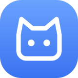
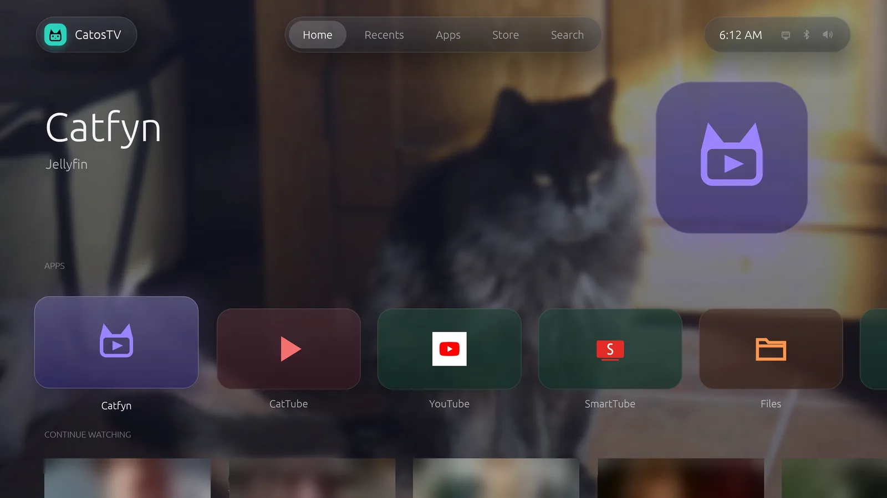
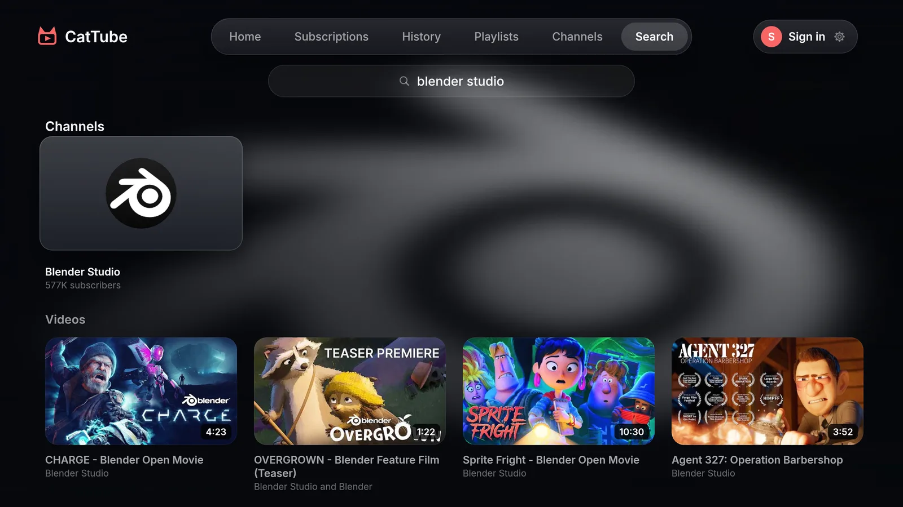
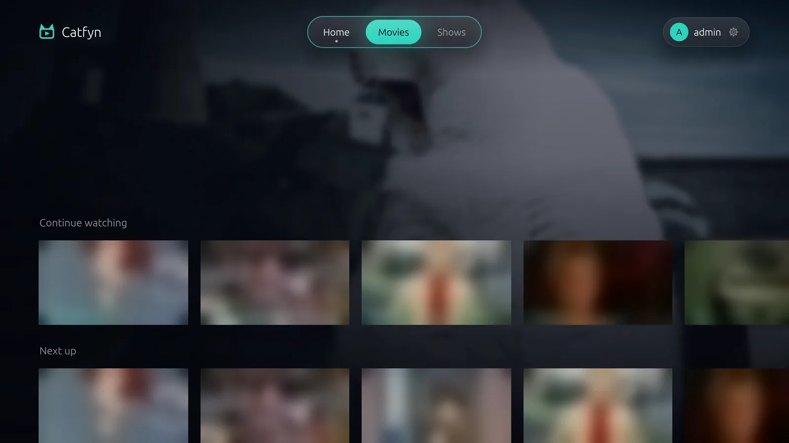
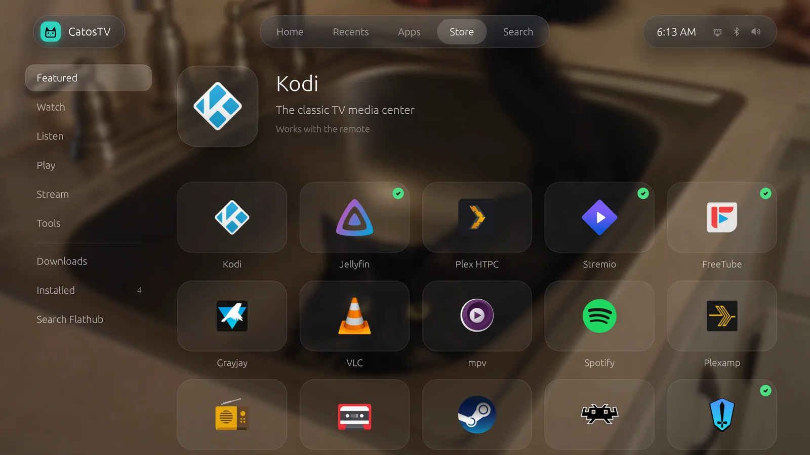
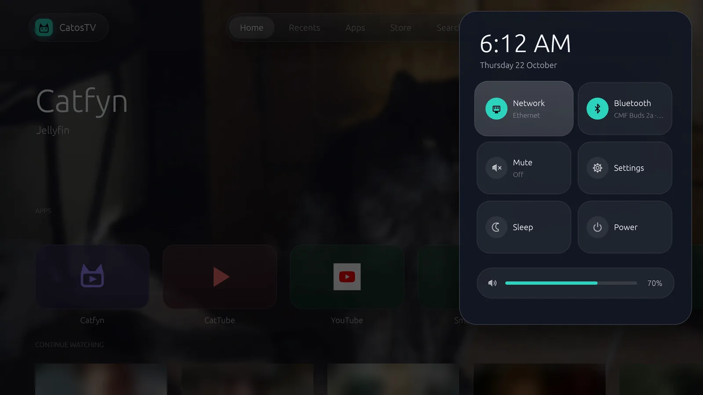

<p align="center">
  
</p>

# CatosTV &nbsp;&middot;&nbsp; [](https://t.me/+0SUpfEJNYFhhNzZh)

**A no-nonsense Linux distro made for TV screens.**



I built CatosTV for my living room because I wanted a home screen for my
apps, without sponsored tiles or rows of things I never asked to watch.

CatosTV turns a mini PC, desktop or laptop into a TV box. It boots straight
into a full-screen interface you can use from the couch with a remote,
keyboard or controller. Pick an app and watch.

The home screen has no ads and CatosTV doesn't require an account. Apps
and streaming services may require their own accounts. The optional
screensaver fetches pictures and local weather from public services.

It's based on Arch Linux, with the home screen, settings, installer and
media interface written in Rust. Install once, then get signed updates
from Settings, together with the Arch packages tested for that version.

## What you get

| | |
|---|---|
|  |  |
| CatTube, for YouTube | Catfyn, for Jellyfin and Plex |
|  |  |
| The Store, apps from Flathub | Quick settings, over any app |

- A home screen you drive with a remote. Your apps in one row, big
  readable text, and everything reachable with arrows, OK and Back.
- Choose Glassy or Flat in Settings, with your own accent colour. Now
  playing cards let you return to a loaded video, with separate cards when
  more than one player is open.
- Android apps, natively. Set up Android TV once from Settings and your
  Android apps sit right next to everything else. They open full screen,
  the remote and controllers work in them, and Back on an app's first
  screen takes you home. See [ANDROID.md](ANDROID.md).
- [CatTube](https://github.com/coderastic/CatTube), a native YouTube app
  with search, subscriptions, watch history, subtitles and phone control.
- [Catfyn](https://github.com/coderastic/Catfyn), a built-in player for your own [Jellyfin](https://jellyfin.org)
  or [Plex](https://www.plex.tv) server (or both): continue watching, next
  episode with a countdown, subtitles.
- Linux apps as well. Moonlight game streaming and a simple file browser are
  there from the start, and Steam (Big Picture), Spotify, Kodi and lots
  more install from the built-in Store (Flathub).
- Recents, to jump back to an app or close it, with a picture of what each
  one was showing.
- Use whatever you have to control it: a keyboard, a game controller, a
  Bluetooth remote, your phone (a remote page in the browser, or KDE
  Connect), or your TV's own remote over HDMI-CEC.
  One press on a keyboard, remote or controller wakes the TV from sleep.
- Cast to it from phone apps that support DLNA, and use "link with TV" in
  the YouTube app. Turn casting on or off in Settings.
- Quick settings for Wi-Fi, Ethernet, Bluetooth, sound, sleep and power,
  one button away, even while an app is open.
- Updates from Settings. They're signed, you choose when to install them,
  and they never start while something is playing.

## Download

Get the latest ISO from the [Releases](https://github.com/CatosTV/CatOSTV/releases/latest) page and write it to
a USB stick (8 GB or more) with [balenaEtcher](https://etcher.balena.io),
[Ventoy](https://www.ventoy.net) or `dd`:

```bash
sudo dd if=catostv-VERSION-x86_64.iso of=/dev/sdX bs=4M status=progress oflag=sync
```

You can check the download with the `.sha256` file next to it:
`sha256sum -c catostv-VERSION-x86_64.iso.sha256`. Replace `VERSION` with
the downloaded version and `/dev/sdX` with the USB device you want to erase.

You don't need a newer ISO when a new version comes out. The installer
checks for updates before it starts and installs the newest version.

The main branch can include changes that aren't in the latest ISO or
update yet. Check the release notes for what's included in a download.

## What you need

- A 64-bit PC (x86-64) that boots in UEFI mode. Almost every PC from the
  last ten years does.
- A disk of 20 GB or more that CatosTV may erase completely. 64 GB or more
  is nicer if you plan to install many Android apps or games.
- An internet connection while installing, over Ethernet or Wi-Fi.
- A TV or monitor over HDMI. The installer selects graphics drivers for
  the hardware it detects.

## Quick start

1. Plug in the USB stick and boot from it (F12, F11 or Esc at power-on
   usually opens the boot menu).
2. Choose **Install CatosTV**. If the screen stays dark on an unusual
   graphics card, try **Install with basic graphics**.
3. Follow the installer: keyboard, network, the disk to use, time zone. It
   shows you the disk and asks before erasing anything.
4. When it says **You're all set**, remove the stick and restart.

The TV starts straight into CatosTV. The [manual](MANUAL.md) covers
everything from there: the remote, apps, Android, casting, settings and
what to do when something misbehaves.

## Building it yourself

CatosTV is built on Arch Linux. On an Arch machine:

```bash
sudo pacman -S --needed base-devel rustup archiso grub ttf-dejavu freetype2
rustup default stable
./scripts/build-iso.sh          # makes out/catostv-<version>-x86_64.iso
```

## Credits

- Android TV images: [SupeChicken666](https://github.com/supechicken) and
  [WayDroid-ATV](https://github.com/WayDroid-ATV/waydroid-builds), whose
  images power CatosTV's Android TV setup.
- Icons: [Papirus](https://github.com/PapirusDevelopmentTeam/papirus-icon-theme)
  icon theme (GPL-3.0).
- Built on [Arch Linux](https://archlinux.org), with
  [labwc](https://labwc.github.io), [Waydroid](https://waydro.id),
  [mpv](https://mpv.io) and [egui](https://github.com/emilk/egui).
- Font: [Inter](https://rsms.me/inter/).

## License

See [LICENSE](LICENSE).
