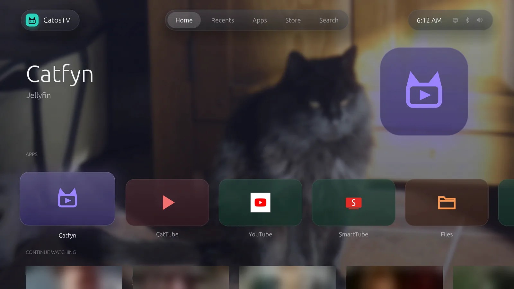
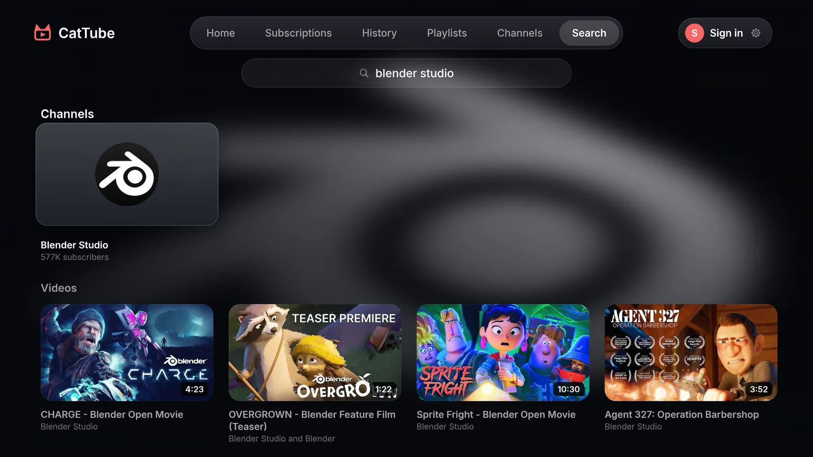
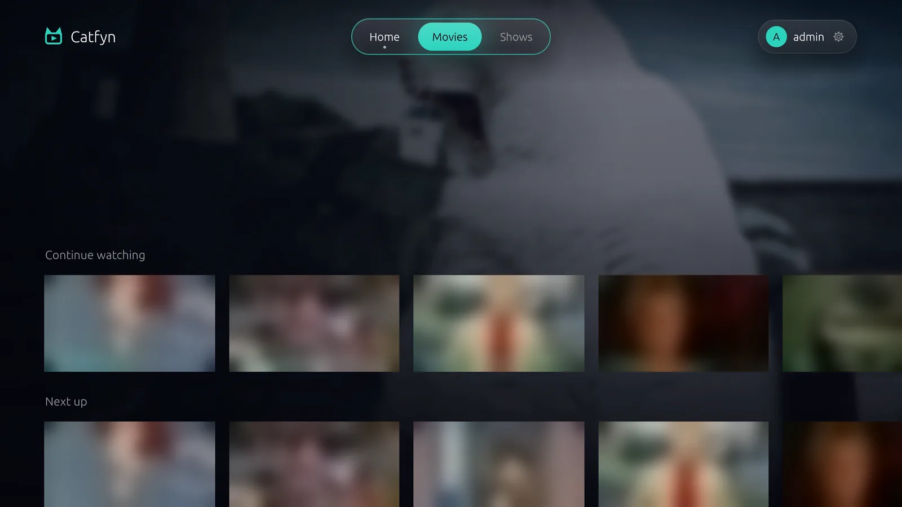
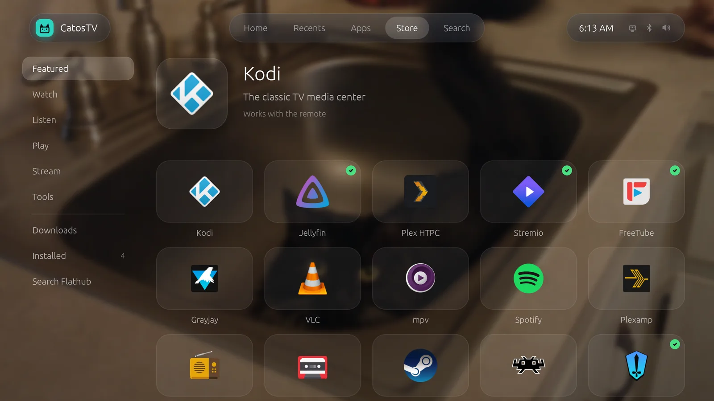
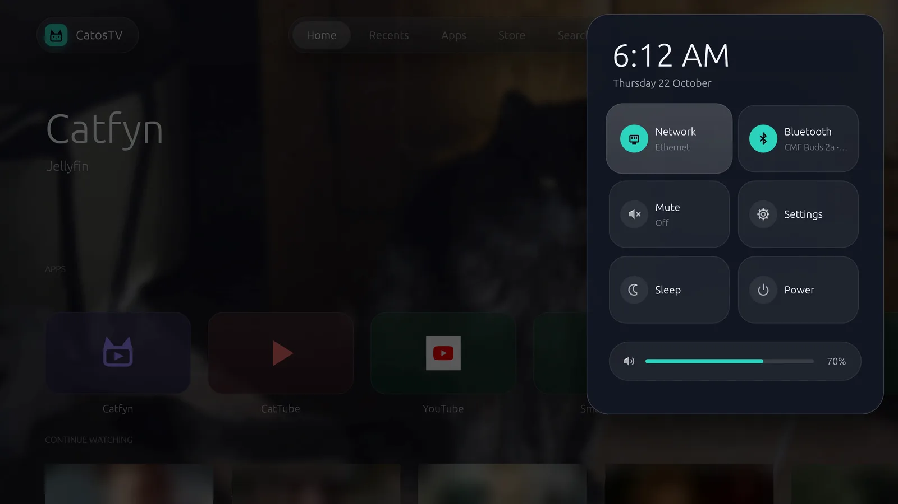

<p align="center">
  
</p>

<h1 align="center">CatosTV</h1>

<p align="center">A no-nonsense Linux distro built for TV screens.</p>

<p align="center">
  <a href="https://github.com/CatosTV/CatOSTV/releases/latest"><strong>Download ISO</strong></a>
  &nbsp;·&nbsp; <a href="MANUAL.md">Manual</a>
  &nbsp;·&nbsp; <a href="ANDROID.md">Android setup</a>
  &nbsp;·&nbsp; <a href="https://t.me/+0SUpfEJNYFhhNzZh">Telegram community</a>
</p>



CatosTV turns an x86-64 PC into a TV box. It boots into a home screen you
can use with a remote, keyboard or controller. The home screen has no ads,
and CatosTV does not require an account.

## On your TV

- **YouTube:** [CatTube](https://github.com/coderastic/CatTube), with search,
  subscriptions, subtitles and phone control.
- **Your media:** Catfyn connects to [Jellyfin](https://jellyfin.org) and
  [Plex](https://www.plex.tv), with continue watching and next-episode playback.
- **Android TV apps:** set up Google Play or Aurora, then open Android apps
  from the same home screen. See the [Android guide](ANDROID.md).
- **Linux apps and games:** install from Flathub in the Store. Moonlight
  and a file browser are included.
- **TV controls:** quick settings, app switching, HDMI-CEC, Bluetooth
  remotes, controllers and a phone remote.
- **Your layout:** choose Flat or Glassy, pick an accent colour and arrange
  your apps.

Apps and streaming services may need their own accounts. Android app
compatibility depends on the app and your hardware.

<details>
<summary>More screenshots</summary>

**CatTube**



**Catfyn** · [Standalone app](https://github.com/coderastic/Catfyn)



**Store**



**Quick settings**



</details>

## Install

You need a **UEFI x86-64 PC**, a disk of **20 GB or more**, an internet
connection and a USB stick of **8 GB or more**. A 64 GB disk gives Android
apps and games more room.

1. Download the ISO and its `.sha256` file from
   [GitHub Releases](https://github.com/CatosTV/CatOSTV/releases/latest).
2. Write the ISO to USB, then boot the PC from it.
3. Choose **Install CatosTV** and follow the installer. Installation erases
   the disk you select. If the display stays dark, try **basic graphics**.
4. Remove the USB stick and restart when installation finishes.

The [manual](MANUAL.md) covers USB creation, keyboard and remote controls,
network setup, apps and troubleshooting.

## Updates

Install signed system updates from **Settings → Updates**. Store app
updates are in **Store → Updates**. You choose when to install them.

GitHub Releases contain installer ISOs and checksums. Installed TVs get
system updates from CatosTV's update service. You do not need a new ISO
for each update. Changes on `main` may be ahead of the published ISO and OTA.

## Build from source

On Arch Linux:

```sh
sudo pacman -S --needed base-devel git rustup archiso grub ttf-dejavu freetype2
rustup default stable
git clone https://github.com/CatosTV/CatOSTV.git
cd CatOSTV
./scripts/build-iso.sh
```

The ISO is written to `out/`.

## Credits and licence

Android TV images come from [SupeChicken666](https://github.com/supechicken)
and [WayDroid-ATV](https://github.com/WayDroid-ATV/waydroid-builds).
CatosTV uses [Arch Linux](https://archlinux.org),
[labwc](https://labwc.github.io), [Waydroid](https://waydro.id),
[mpv](https://mpv.io), [egui](https://github.com/emilk/egui),
[Papirus icons](https://github.com/PapirusDevelopmentTeam/papirus-icon-theme)
(GPL-3.0) and the [Inter font](https://rsms.me/inter/).

CatosTV is licensed under [MIT](LICENSE). Included software and assets
retain their own licences.
